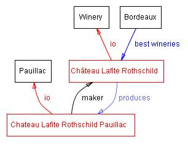
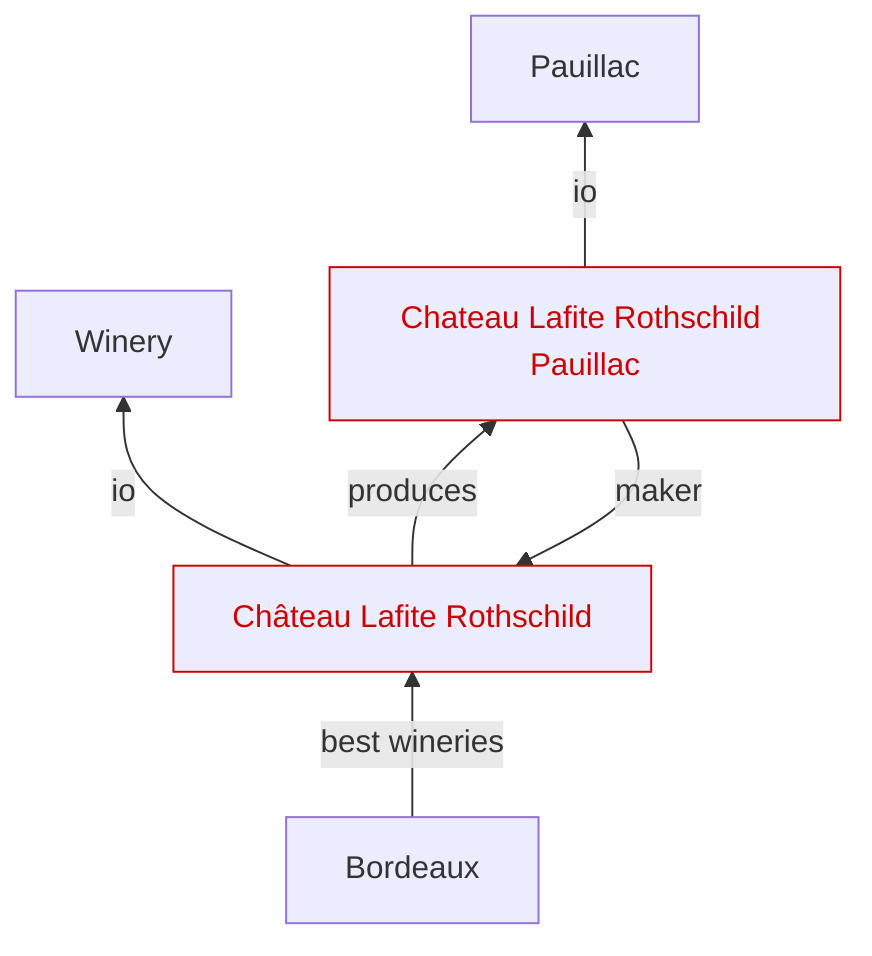

# 2 オントロジーには何が含まれるのか（What is in an ontology?）

[目次へ戻る](README.md) ／ [原文（英語）](https://protege.stanford.edu/publications/ontology_development/ontology101-noy-mcguinness.html)

人工知能の文献には、オントロジーの定義がたくさんあり、その多くは互いに食い違っている。このガイドでは、**オントロジー**とは、議論領域（domain of discourse）における概念（**クラス**（class）。**概念**と呼ばれることもある）、各概念のさまざまな特徴や属性を記述するプロパティ（**スロット**（slot）。**ロール**（role）や**プロパティ**（property）と呼ばれることもある）、そしてスロットに対する制約（**ファセット**（facet）。**ロール制約**（role restriction）と呼ばれることもある）を、形式的かつ明示的に記述したもの、とする。オントロジーに、クラスの個々の**インスタンス**（instance）の集まりを加えたものが、**知識ベース**となる。実際には、どこまでがオントロジーでどこからが知識ベースかの境目は、ごく微妙である。

ほとんどのオントロジーでは、クラスが中心となる。クラスはドメインの概念を記述する。たとえば、ワインのクラスはすべてのワインを表す。個々のワインはこのクラスのインスタンスである。あなたがこの文書を読んでいる今、目の前のグラスに入っているボルドーワインは、ボルドーワインのクラスのインスタンスである。クラスは、そのスーパークラス（superclass）よりも具体的な概念を表す**サブクラス**（subclass）を持つことができる。たとえば、すべてのワインのクラスを、赤ワイン、白ワイン、ロゼワインに分けることができる。あるいは、すべてのワインのクラスを、スパークリングワインとスパークリングでないワインに分けることもできる。

スロットは、クラスやインスタンスのプロパティを記述する。たとえば、`Château Lafite Rothschild Pauillac` というワインはフルボディであり、`Château Lafite Rothschild` というワイナリーで造られている。この例には、ワインを記述するスロットが二つある。値が full（フル）である body スロットと、値が `Château Lafite Rothschild` ワイナリーである maker スロットである。クラスのレベルでは、クラス `Wine` のインスタンスは、その `flavor`（風味）、`body`（ボディ）、`sugar level`（糖度）、ワインの `maker`（造り手）などを記述するスロットを持つ、と言うことができる。[1]

クラス `Wine` と、そのサブクラスである Pauillac のすべてのインスタンスは、スロット `maker` を持ち、その値はクラス Winery のインスタンスである（図 1）。クラス Winery のすべてのインスタンスはスロット `produces` を持ち、このスロットは、そのワイナリーが造るすべてのワイン（クラス Wine とそのサブクラスのインスタンス）を指す。

実際的に言えば、オントロジーを開発するとは、次のことを含む。

- オントロジーのクラスを定義する

- クラスを分類階層（taxonomic hierarchy。サブクラス―スーパークラスの階層）に並べる

- スロットを定義し、それらのスロットの許容値（allowed value）を記述する

- インスタンスについて、スロットの値を埋める

そのうえで、これらのクラスの個々のインスタンスを定義し、具体的なスロット値（slot value）の情報や追加のスロット制約を埋めることで、知識ベースを作ることができる。

- 黒い枠はクラス、赤い枠はインスタンス。
- 【訳注】矢印の「io」は、説明文にある instance-of（〜のインスタンスである）を指すと思われる。

**図 1. ワインのドメインにおける、いくつかのクラス、インスタンス、そしてそれらの間の関係。クラスは黒、インスタンスは赤で示した。直接のリンクはスロットを表し、内部のリンクは instance-of や subclass-of などを表す。**

---

**原注**

[1] 私たちは、クラス名を大文字で始め、スロット名を小文字で始める。また、例のオントロジーに出てくる用語にはすべて `typewriter font`（等幅字体）を使う。
