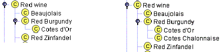
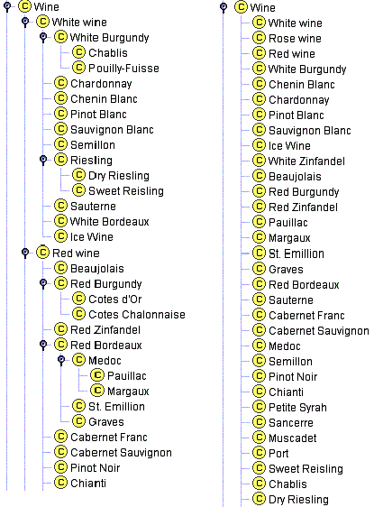
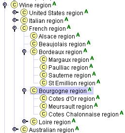

# 4 クラスとクラス階層を定義する（Defining classes and a class hierarchy）

[目次へ戻る](README.md) ／ [原文（英語）](https://protege.stanford.edu/publications/ontology_development/ontology101-noy-mcguinness.html)

この節では、クラスとクラス階層を定義するとき（第 3 節のステップ 4）に気をつけるべき点と、犯しやすい誤りについて論じる。前にも述べたように、どのドメインについても、唯一の正しいクラス階層というものはない。階層は、オントロジーの使い道として考えられるもの、アプリケーションに必要な詳しさの度合い、個人の好み、そして場合によってはほかのモデルとの互換性の要件によって決まる。とはいえ、クラス階層を作るときに心に留めておくべき指針をいくつか論じる。新しいクラスをかなりの数定義したら、一歩引いて、できつつある階層がこれらの指針に沿っているかを確かめるとよい。

## 4.1 クラス階層が正しいことを確かめる

#### 「is-a」関係

クラス階層は「is-a」関係（is-a relation）を表す。クラス A のすべてのインスタンスがクラス B のインスタンスでもあるならば、クラス A は B のサブクラスである。たとえば、`Chardonnay` は `White wine` のサブクラスである。分類上の関係のもう一つの考え方は、「kind-of」関係（kind-of relation）とみなすことである。`Chardonnay` は `White wine` の一種である。ジェット旅客機は航空機の一種である。肉は食べ物の一種である。

> *クラスのサブクラスは、スーパークラスが表す概念の「一種」である概念を表す。*

#### 一本のワインは、すべてのワインのサブクラスではない

よくあるモデリングの誤りは、同じ概念の単数形と複数形の両方を階層に入れ、前者を後者のサブクラスにしてしまうことである。たとえば、クラス `Wines` を定義し、`Wines` のサブクラスとしてクラス `Wine` を定義するのは誤りである。階層が「kind-of」関係を表していると考えれば、このモデリングの誤りは明らかになる。一本の `Wine` は `Wines` の**一種**ではない。このような誤りを避ける最善の方法は、クラスに名前を付けるときに、常に単数形だけ、または複数形だけを使うことである（概念の名前の付け方については第 6 節を参照）。

#### 階層関係の推移性（transitivity）

サブクラスの関係は推移的（transitive）である。

> *B が A のサブクラスで、C が B のサブクラスならば、C は A のサブクラスである*

たとえば、クラス `Wine` を定義し、次にクラス `White wine` を `Wine` のサブクラスとして定義できる。さらに、クラス `Chardonnay` を `White wine` のサブクラスとして定義する。サブクラスの関係が推移的であるということは、クラス `Chardonnay` は `Wine` のサブクラスでもあるということである。直接のサブクラスと間接のサブクラスを区別することもある。**直接のサブクラス**（direct subclass）とは、そのクラスに「最も近い」サブクラスのことである。つまり、階層の中で、あるクラスとその直接のサブクラスの間にはほかのクラスがない。言い換えると、階層の中で、あるクラスとその直接のスーパークラス（direct superclass）の間にはほかのクラスがない。私たちの例では、`Chardonnay` は `White wine` の直接のサブクラスであり、`Wine` の直接のサブクラスではない。

#### クラス階層の進化

ドメインが変化していくにつれて、一貫したクラス階層を保つのは難しくなることがある。たとえば、長年にわたって、ジンファンデルのワインはすべて赤であった。そこで、`Zinfandel` ワインのクラスを `Red wine` クラスのサブクラスとして定義する。ところが、あるときから、ワインの造り手たちは、ブドウを圧搾したらすぐに、ブドウの色を生み出す部分を取り除くようになった。それによって、できあがるワインの色が変わった。こうして、色がロゼの「ホワイト・ジンファンデル」ができる。そこで、`Zinfandel` クラスを、ジンファンデルの二つのクラス――`White zinfandel` と `Red zinfandel`――に分け、それぞれを `Rose wine` と `Red wine` のサブクラスとして分類する必要が出てくる。

#### クラスとその名前

クラスと、その名前とを区別することが重要である。

> *クラスはドメインの概念を表すのであって、それらの概念を指す言葉を表すのではない。*

別の用語体系を選べば、クラスの名前は変わるかもしれない。しかし、その用語自体は、世界の客観的な現実を表している。たとえば、クラス `Shrimps` を作り、それを `Prawns` という名前に変えることができる。クラスは依然として同じ概念を表している。shrimp の料理を指していたワインのふさわしい組み合わせは、prawn の料理を指すべきである。より実際的に言えば、次の規則に常に従うべきである。

> *同じ概念の同義語は、別々のクラスを表すのではない*

同義語は、ある概念や用語の別の名前にすぎない。したがって、`Shrimp` というクラスと `Prawn` というクラス、さらにはおそらく `Crevette` というクラスを持つべきでは**ない**。そうではなく、`Shrimp` か `Prawn` のどちらかの名前を持つ一つのクラスがあるべきである。多くのシステムでは、同義語、翻訳、表示用の名前のリストをクラスに関連づけることができる。システムがこのような関連づけを許さない場合でも、同義語はいつでもクラスの説明文に書いておける。

#### クラスの循環を避ける

クラス階層の中の**循環**（cycle）は避けるべきである。あるクラス A がサブクラス B を持ち、同時に B が A のスーパークラスでもあるとき、階層に循環があると言う。階層にこのような循環を作ることは、クラス A と B が等価であると宣言することに等しい。つまり、A のすべてのインスタンスは B のインスタンスであり、B のすべてのインスタンスもまた A のインスタンスである。実際、B は A のサブクラスなので、B のすべてのインスタンスはクラス A のインスタンスでなければならない。また、A は B のサブクラスなので、A のすべてのインスタンスもクラス B のインスタンスでなければならない。

## 4.2 クラス階層の中の兄弟を分析する

#### クラス階層の中の兄弟

階層の中の**兄弟**（sibling）とは、同じクラスの直接のサブクラスであるクラスのことである（4.1 節を参照）。

> *階層の中のすべての兄弟は（根にあるものを除いて）、同じ一般性のレベルになければならない。*

たとえば、`White wine` と `Chardonnay` を、同じクラス（たとえば `Wine`）のサブクラスにすべきではない。`White wine` は `Chardonnay` よりも一般的な概念である。兄弟は、本の中で同じレベルにある節同士が同じ一般性のレベルにあるのと同じように、「同じ線上」に並ぶ概念を表すべきである。その意味で、クラス階層に求められることは、本の目次（アウトライン）に求められることに似ている。

ただし、階層の根にある概念（しばしば、`Thing` のような非常に一般的なクラスの直接のサブクラスとして表される）は、ドメインの大きな区分を表すので、似た概念である必要はない。

#### 多すぎるとはいくつからで、少なすぎるとはいくつまでか

クラスが持つべき直接のサブクラスの数について、厳密な規則はない。しかし、よく構造化されたオントロジーの多くでは、直接のサブクラスの数は 2 から 12 程度である。そこで、次の二つの指針がある。

> *クラスに直接のサブクラスが一つしかないなら、モデリングに問題があるか、オントロジーが完成していない可能性がある。*

> *あるクラスのサブクラスが 12 を超えるなら、追加の中間カテゴリが必要かもしれない。*

二つの規則のうち一つ目は、箇条書きの項目が一つだけであってはならない、という組版の規則に似ている。たとえば、赤のブルゴーニュワインの大部分は、コート・ドールのワインである。ブルゴーニュワインのうち、この大多数の種類だけを表したいとしよう。クラス `Red Burgundy` を作り、その唯一のサブクラスとして `Cotes d’Or` を作ることができる（図 6a）。しかし、私たちの表現の中で、赤のブルゴーニュワインとコート・ドールのワインが本質的に等価である（赤のブルゴーニュワインはすべてコート・ドールのワインであり、コート・ドールのワインはすべて赤のブルゴーニュワインである）なら、`Cotes d’Or` クラスを作る必要はなく、表現に新しい情報を何も加えない。コート・ドールのすぐ南の地域で造られる、より安価なブルゴーニュワインであるコート・シャロネーズのワインを含めるなら、`Burgundy` クラスのサブクラスを二つ作ることになる。`Cotes d’Or` と `Cotes Chalonnaise` である（図 6b）。



(a) サブクラスが一つだけの場合

```text
Red wine
├─ Beaujolais
├─ Red Burgundy
│  └─ Cotes d'Or
└─ Red Zinfandel
```

(b) サブクラスが二つの場合

```text
Red wine
├─ Beaujolais
├─ Red Burgundy
│  ├─ Cotes d'Or
│  └─ Cotes Chalonnaise
└─ Red Zinfandel
```

- 【訳注】原文の図には (a)(b) の文字がなく、本文の説明に合わせて、左の図を (a)、右の図を (b) とした。

**図 6. `Red Burgundy` クラスのサブクラス。クラスのサブクラスが一つしかないことは、たいていモデリングの問題を示している。**

今度は、ワインのすべての種類を `Wine` クラスの直接のサブクラスとして並べたとしよう。すると、このリストには、ボージョレやボルドーのような、より一般的なワインの種類と、ポイヤックやマルゴーのような、より具体的な種類が一緒に含まれることになる（図 7a）。クラス `Wine` の直接のサブクラスは多すぎる。実際、オントロジーがさまざまな種類のワインをよりよく整理された形で反映するには、`Medoc` は `Bordeaux` のサブクラスであるべきであり、`Cotes d’Or` は `Burgundy` のサブクラスであるべきである。また、`Red wine` や `White wine` のような中間カテゴリを持つことは、多くの人が持っているワインのドメインの概念モデルを反映することにもなる（図 7b）。

【訳注】この段落の図番号は、PDF 版では「図 6a」「図 6b」となっている。内容は図 7 を指しているため、Web ページ版の「図 7a」「図 7b」に従った。

しかし、長い兄弟のリストの中の概念をまとめる自然なクラスがないなら、人為的なクラスを作る必要はない――クラスはそのままにしておけばよい。結局のところ、オントロジーは現実世界を映したものであり、現実世界に分類がないなら、オントロジーもそれを反映すべきである。



(a) すべての種類を `Wine` の直接のサブクラスとして並べた場合

```text
Wine
├─ White wine
├─ Rose wine
├─ Red wine
├─ White Burgundy
├─ Chenin Blanc
├─ Chardonnay
├─ Pinot Blanc
├─ Sauvignon Blanc
├─ Ice Wine
├─ White Zinfandel
├─ Beaujolais
├─ Red Burgundy
├─ Red Zinfandel
├─ Pauillac
├─ Margaux
├─ St. Emillion
├─ Graves
├─ Red Bordeaux
├─ Sauterne
├─ Cabernet Franc
├─ Cabernet Sauvignon
├─ Medoc
├─ Semillon
├─ Pinot Noir
├─ Chianti
├─ Petite Syrah
├─ Sancerre
├─ Muscadet
├─ Port
├─ Sweet Reisling
├─ Chablis
└─ Dry Riesling
```

(b) 分類のレベルをいくつか設けた場合

```text
Wine
├─ White wine
│  ├─ White Burgundy
│  │  ├─ Chablis
│  │  └─ Pouilly-Fuisse
│  ├─ Chardonnay
│  ├─ Chenin Blanc
│  ├─ Pinot Blanc
│  ├─ Sauvignon Blanc
│  ├─ Semillon
│  ├─ Riesling
│  │  ├─ Dry Riesling
│  │  └─ Sweet Reisling
│  ├─ Sauterne
│  ├─ White Bordeaux
│  └─ Ice Wine
└─ Red wine
   ├─ Beaujolais
   ├─ Red Burgundy
   │  ├─ Cotes d'Or
   │  └─ Cotes Chalonnaise
   ├─ Red Zinfandel
   ├─ Red Bordeaux
   │  ├─ Medoc
   │  │  ├─ Pauillac
   │  │  └─ Margaux
   │  ├─ St. Emillion
   │  └─ Graves
   ├─ Cabernet Franc
   ├─ Cabernet Sauvignon
   ├─ Pinot Noir
   └─ Chianti
```

- 【訳注】原文の図では、どちらの一覧も、最後のクラス名の下に木の線が続いており、この下にさらにクラスが続いている可能性がある。原文の図には (a)(b) の文字がなく、本文の説明に合わせて翻訳者が (a)(b) を割り当てた（原文の図では、右の図が (a)、左の図が (b) にあたる）。クラス名の綴り（Sweet Reisling など）は原文の図のとおり。

**図 7. ワインの分類。すべてのワインとワインの種類を並べた場合と、分類のレベルをいくつか設けた場合の比較。**

## 4.3 多重継承

ほとんどの知識表現システムでは、クラス階層で**多重継承**（multiple inheritance）が許される。つまり、クラスはいくつものクラスのサブクラスになれる。デザートワインの別のクラス、`Dessert wine` クラスを作りたいとしよう。ポートワインは、赤ワインでもあり、デザートワインでもある。[4] そこで、クラス `Port` を、二つのスーパークラス `Red wine` と `Dessert wine` を持つものとして定義する。`Port` クラスのすべてのインスタンスは、`Red wine` クラスと `Dessert wine` クラスの両方のインスタンスになる。`Port` クラスは、そのスロットとそれらのファセットを、両方の親から継承する。したがって、`Dessert wine` クラスからはスロット `Sugar` の値 SWEET（甘口）を継承し、`Red wine` クラスからは `tannin level` スロットと color スロットの値を継承する。

## 4.4 新しいクラスを導入すべきとき（そうでないとき）

モデリング中に下す判断の中で最も難しいものの一つは、新しいクラスを導入すべきときと、違いを異なるプロパティ値で表すべきときの見極めである。余計なクラスがたくさんある、極端に入れ子になった階層も、クラスが少なすぎてスロットに情報が詰め込まれすぎている、とても平らな階層も、どちらもたどるのが難しい。しかし、適切なバランスを見つけるのは簡単ではない。

階層に新しいクラスを導入すべきときを決めるのに役立つ、経験則がいくつかある。

> *クラスのサブクラスは、ふつう、(1) スーパークラスにはない追加のプロパティを持つか、(2) スーパークラスとは異なる制約を持つか、(3) スーパークラスとは異なる関係に関わる*

赤ワインはタンニンの度合いがさまざまでありうるが、このプロパティはワイン一般を記述するのには使われない。Dessert wine の sugar スロットの値は SWEET であるが、これは Dessert Wine クラスのスーパークラスには当てはまらない。ピノ・ノワールのワインはシーフードに合うかもしれないが、ほかの赤ワインは合わない。言い換えると、ふつう私たちが階層に新しいクラスを導入するのは、スーパークラスについては言えないが、このクラスについては言える何かがあるときだけである。

実際的に言えば、各サブクラスは、新しいスロットが追加されるか、新しいスロット値が定義されるか、継承したスロットのファセットのいくつかを上書きするか、のいずれかであるべきである。

しかし、新しいプロパティを何も導入しなくても、新しいクラスを作ると便利な場合もある。

> *用語階層（terminological hierarchy）のクラスは、新しいプロパティを導入しなくてもよい*

たとえば、ドメインで使われる一般的な用語の、大規模な参照用の階層を含むオントロジーがある。たとえば、電子カルテシステムの土台となるオントロジーには、さまざまな病気の分類が含まれるかもしれない。この分類は、まさに用語の階層にすぎないかもしれない。つまり、プロパティを持たない（あるいは、同じプロパティの集まりを持つ）用語の階層である。その場合でも、用語を平らなリストではなく階層に整理しておくことは役に立つ。そうすれば、(1) 探索やたどることが容易になり、(2) 医師が状況にふさわしい一般性のレベルの用語を簡単に選べるようになるからである。

新しいプロパティを持たない新しいクラスを導入するもう一つの理由は、ドメインの専門家がふつう区別している概念をモデル化するためである。たとえ、その区別そのものはモデル化しないと決めていたとしてもである。私たちはオントロジーを、ドメインの専門家の間や、ドメインの専門家と知識ベースのシステムとの間のコミュニケーションを助けるために使うのだから、専門家のドメインの見方をオントロジーに反映させたい。

最後に、追加の制約ごとにクラスのサブクラスを作るべきではない。たとえば、私たちは `Red wine`、`White wine`、`Rose wine` というクラスを導入した。この区別はワインの世界では自然なものだからである。一方、繊細なワイン、中程度のワインなどのクラスは導入しなかった。クラス階層を定義するときの目標は、クラスの整理に役立つ新しいクラスを作ることと、クラスを作りすぎることとの間で、バランスを取ることである。

## 4.5 新しいクラスか、プロパティ値か

ドメインをモデル化するときには、特定の区別（白ワイン、赤ワイン、ロゼワインなど）をプロパティ値としてモデル化するか、クラスの集まりとしてモデル化するかを決める必要がよくある。これもまた、ドメインの範囲と、手元の作業によって決まる。

クラス `White wine` を作るのか、それとも単にクラス `Wine` を作って、スロット `color` に異なる値を入れるのか。答えはふつう、オントロジーについて定めた範囲の中にある。私たちのドメインで、`White wine` という概念はどれくらい重要か。ドメインの中でワインがわずかな重要性しか持たず、ワインが白かどうかが、ほかの物との関係に特に何の影響も持たないなら、白ワインのために別のクラスを導入すべきではない。ワインのラベルを製造する工場で使うドメインモデルなら、どの色のワインのラベルでも規則は同じであり、この区別はあまり重要ではない。一方、ワインと料理とそれらのふさわしい組み合わせを表現するなら、赤ワインは白ワインと大きく異なる。組み合わせる料理が違い、プロパティが違う、などである。同様に、ワインのテイスティングの順序を決めるのに使うかもしれないワインの知識ベースでも、ワインの色は重要である。そこで、`White wine` のための別のクラスを作る。

> *異なるスロット値を持つ概念が、ほかのクラスの異なるスロットに対する制約になるなら、その区別のために新しいクラスを作るべきである。そうでなければ、その区別はスロット値で表す。*

同じように、私たちのワインのオントロジーには、すべてのメルローワインのための一つのクラスではなく、`Red Merlot` と `White Merlot` のようなクラスがある。赤のメルローと白のメルローは（同じブドウから造られてはいても）本当に異なるワインであり、ワインの詳しいオントロジーを開発しているなら、この区別は重要である。

> *ある区別がドメインで重要であり、その区別について異なる値を持つ物を、異なる種類の物だと考えるのであれば、その区別のために新しいクラスを作るべきである。*

クラスの個々のインスタンスとして考えられるものを検討することも、新しいクラスを導入するかどうかを決める助けになる。

> *個々のインスタンスが属するクラスは、頻繁に変わるべきではない。*

ふつう、クラスを区別するのに、概念の内在的なプロパティではなく外在的なプロパティを使うと、それらのクラスのインスタンスは、あるクラスから別のクラスへ頻繁に移らなければならなくなる。たとえば、レストランのワインボトルを記述するオントロジーでは、`Chilled wine`（冷やしたワイン）をクラスにすべきではない。`chilled`（冷えている）というプロパティは、単にボトルの中のワインの属性にすべきである。`Chilled wine` のインスタンスは、簡単にこのクラスのインスタンスでなくなり、また再びこのクラスのインスタンスになりうるからである。

ふつう、数、色、場所はスロット値であり、新しいクラスを作る理由にはならない。しかし、ワインは注目すべき例外である。ワインの色は、ワインを記述するうえでそれほど重要だからである。

別の例として、人体解剖学のオントロジーを考えよう。肋骨を表すとき、「左第 1 肋骨」「左第 2 肋骨」などのそれぞれについてクラスを作るだろうか。それとも、順番と左右の位置のスロットを持つ Rib（肋骨）クラスを一つ持つだろうか。[5] オントロジーで表す肋骨それぞれの情報が大きく異なるなら、実際に肋骨ごとにクラスを作るべきである。つまり、隣接関係や位置の詳しい情報（肋骨ごとに異なる）や、各肋骨が果たす特定の機能や守っている臓器を表したいなら、クラスが必要である。解剖学を、やや低い一般性のレベル（a slightly lesser level of generality）でモデル化していて、想定するアプリケーションにとってはどの肋骨もとても似ている（X 線写真でどの肋骨が折れているかを話題にするだけで、体のほかの部分への影響は扱わない）なら、階層を単純にして、二つのスロット `lateral position`（左右の位置）、`order`（順番）を持つクラス `Rib` だけにしたほうがよいだろう。

【訳注】「やや低い一般性のレベル」は、原文の表現をそのまま訳したものである。前後の文脈（どの肋骨も同じように扱い、階層を単純にする）からは、「詳しさをやや抑えたレベル」という意味と思われる。

## 4.6 インスタンスか、クラスか

ある概念をオントロジーのクラスにするか、個々のインスタンスにするかは、そのオントロジーの使い道として何が考えられるかによって決まる。クラスがどこで終わり、個々のインスタンスがどこから始まるかを決めるには、まず、表現の粒度（granularity）の最も細かいレベルを決める。粒度のレベルは、今度はオントロジーの使い道として考えられるアプリケーションによって決まる。言い換えると、知識ベースで表す最も具体的な項目は何か、ということである。第 3 節のステップ 1 で挙げたコンピテンシー質問に戻ると、それらの質問の答えになる最も具体的な概念が、知識ベースの個体のとてもよい候補である。

> *個々のインスタンスは、知識ベースで表す最も具体的な概念である。*

たとえば、ワインと料理の組み合わせだけを話題にするのであれば、ワインの具体的な一本一本のボトルには関心がないだろう。したがって、`Sterling Vineyards Merlot` のような用語が、おそらく私たちが使う最も具体的な用語になる。言い換えると、Wine クラスは、ワインの一本一本のボトルの集まりではなく、特定のワイナリーが造る特定のワインの集まりである。したがって、`Sterling Vineyards Merlot` は知識ベースのインスタンスになるだろう。

一方、ワインと料理のよい組み合わせの知識ベースに加えて、レストランのワインの在庫も管理したいのであれば、各ワインの一本一本のボトルが、知識ベースの個々のインスタンスになるかもしれない。

同じように、`Sterling Vineyards Merlot` の特定のヴィンテージごとに異なるプロパティを記録したいのであれば、そのワインの特定のヴィンテージが知識ベースのインスタンスとなり、`Sterling Vineyards Merlot` は、そのすべてのヴィンテージをインスタンスとして含むクラスとなる。

別の規則によって、個々のインスタンスのいくつかがクラスの集まりへと「移る」ことがある。

> *概念が自然な階層をなすなら、それらをクラスとして表すべきである*

ワインの産地を考えよう。最初は、フランス、アメリカ合衆国、ドイツなどの主なワイン産地をクラスとして定義し、これらの大きな産地の中の個別のワイン産地をインスタンスとして定義するかもしれない。たとえば、`Bourgogne region` は `French region` クラスのインスタンスである。しかし、`Cotes d’Or region` は `Bourgogne region` である、とも言いたい。したがって、`Bourgogne region` はクラスでなければならない（サブクラスやインスタンスを持つためには）。しかし、`Bourgogne region` をクラスにし、`Cotes d’Or region` を `Bourgogne region` のインスタンスにするのは、恣意的に思える。どの産地がクラスで、どの産地がインスタンスかをはっきり区別するのは、とても難しい。そこで、すべてのワイン産地をクラスとして定義する。Protégé-2000 では、利用者がいくつかのクラスを Abstract（抽象）と指定できる。これは、そのクラスが直接のインスタンスを持てないことを示す。私たちの例では、産地のクラスはすべて抽象クラス（abstract class）である（図 8）。



```text
Wine region (A)
├─ United States region (A)
├─ Italian region (A)
├─ French region (A)
│  ├─ Alsace region (A)
│  ├─ Beaujolais region (A)
│  ├─ Bordeaux region (A)
│  │  ├─ Margaux region (A)
│  │  ├─ Paulliac region (A)
│  │  ├─ Sauterne region (A)
│  │  └─ St Emillion region (A)
│  ├─ Bourgogne region (A)
│  │  ├─ Cotes d'Or region (A)
│  │  ├─ Meursault region (A)
│  │  └─ Cotes Chalonnaise region (A)
│  └─ Loire region (A)
└─ Australian region (A)
```

- (A) は、抽象クラスを示す「A」のアイコン。

**図 8. ワイン産地の階層。クラス名の横の「A」のアイコンは、そのクラスが抽象クラスであり、直接のインスタンスを持てないことを示す。**

クラス名から「region」という語を省くと、同じクラス階層は誤りになる。クラス `Alsace` がクラス `France` のサブクラスである、とは言えない。アルザスはフランスの一種ではないからである。しかし、アルザス地方（Alsace region）はフランスの地方（French region）の一種である。

階層に並べられるのはクラスだけである――知識表現システムには、サブインスタンスという考え方がない。したがって、4.4 節の用語階層（terminological hierarchy）のように、用語の間に自然な階層があるなら、それらの用語は、それ自体のインスタンスを持たないかもしれないとしても、クラスとして定義すべきである。


## 4.7 範囲を限定する

クラス階層の定義について最後に一言述べておく。オントロジーの定義が完成したかどうかを判断するには、次の規則の組が常に役に立つ。

> *オントロジーは、ドメインについてありうるすべての情報を含むべきではない。アプリケーションに必要な以上に特殊化（または一般化）する必要はない（多くとも、それぞれの方向に一つ余分なレベルまで）。*

私たちのワインと料理の例では、ラベルにどんな紙が使われているかや、エビ料理の作り方を知る必要はない。

同じように、

> *オントロジーは、階層の中のクラスのありうるすべてのプロパティや、クラスの間のありうるすべての区別を含むべきではない。*

私たちのオントロジーには、ワインや料理が持ちうるすべてのプロパティは、当然含まれていない。私たちは、オントロジーの中のものの各クラスについて、最も目立つプロパティを表した。ワインの本にはブドウの粒の大きさが載っているだろうが、私たちはこの知識を含めていない。同じように、私たちのシステムのすべての用語の間に想像しうるすべての関係を加えたわけでもない。たとえば、私たちが定義した用語の間のつながりをすべて、より完全に表せるようにするというだけの理由で、`favorite wine`（好きなワイン）や `favorite food`（好きな料理）のような関係をオントロジーに含めることはしていない。

最後の規則は、オントロジーにすでに含めた概念の間に関係を設けることにも当てはまる。生物学の実験を記述するオントロジーを考えよう。このオントロジーには、おそらく `Biological organisms`（生物）という概念が含まれる。また、実験を行う `Experimenter`（実験者）という概念（その人の名前、所属などを持つ）も含まれるだろう。たしかに、実験者は人間として、生物でもある。しかし、おそらくこの区別をオントロジーに組み込むべきではない。この表現の目的にとって、実験者は生物ではないし、実験者そのものを対象に実験を行うことも、おそらくないだろう。オントロジーのクラスについて言えることをすべて表すのであれば、`Experimenter` は `Biological Organism` のサブクラスになるだろう。しかし、予見できるアプリケーションのためにこの知識を含める必要はない。実際、既存のクラスにこの種の追加の分類を加えることは、かえって害になる。そうすると、Experimenter のインスタンスは、体重、年齢、種など、生物に関わるが実験を記述するという文脈ではまったく無関係なデータのスロットを持つことになる。ただし、このような設計上の判断は、このオントロジーを見ることになる利用者、つまり私たちが念頭に置いていたアプリケーションを知らないかもしれない利用者のために、説明文に記録しておくべきである。そうしないと、このオントロジーをほかのアプリケーションに再利用しようとする人が、もとのモデリングにはその事実が含まれていなかったことを知らずに、experimenter（実験者）を person（人）のサブクラスとして使おうとするかもしれない。

## 4.8 互いに素なサブクラス

多くのシステムでは、いくつかのクラスが**互いに素**（disjoint）であることを明示的に指定できる。共通のインスタンスを一つも持てないとき、クラスは互いに素である。たとえば、私たちのオントロジーの `Dessert wine` クラスと `White wine` クラスは、互いに素では*ない*。両方のインスタンスであるワインはたくさんある。`Sweet Riesling` クラスのインスタンスである `Rothermel Trochenbierenauslese Riesling` は、その一例である。一方、`Red wine` クラスと `White wine` クラスは互いに素である。赤と白に同時になれるワインはない。クラスが互いに素であることを指定しておくと、システムはオントロジーをよりよく検証できる。`Red wine` クラスと `White wine` クラスが互いに素であると宣言しておけば、後で `Riesling`（`White wine` のサブクラス）と `Port`（`Red wine` のサブクラス）の両方のサブクラスであるクラスを作ったときに、システムはモデリングの誤りがあることを指摘できる。

---

**原注**

[4] 私たちのオントロジーでは、赤のポートワインだけを表すことにした。白のポートワインも存在するが、非常にまれである。

[5] ここでは、解剖学上の各器官はクラスであると仮定している。「John の左第 1 肋骨」についても話題にしたいからである。実在する人の個々の器官は、私たちのオントロジーでは個体として表される。
