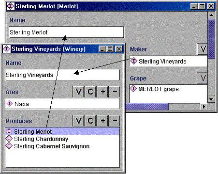

# 5 プロパティの定義――さらに詳しく（Defining properties—more details）

[目次へ戻る](README.md) ／ [原文（英語）](https://protege.stanford.edu/publications/ontology_development/ontology101-noy-mcguinness.html)

この節では、オントロジーのスロットを定義するとき（第 3 節のステップ 5 とステップ 6）に心に留めておくべき、さらにいくつかの詳細を論じる。主に、逆スロットと、スロットのデフォルト値（default value）について論じる。

## 5.1 逆スロット

あるスロットの値が、別のスロットの値に依存することがある。たとえば、ある `wine` がある `winery` によって `produced by`（造られた）なら、その `winery` はその `wine` を `produces`（造る）。この二つの関係、`maker` と `produces` は、**逆関係**（inverse relation）と呼ばれる。情報を「両方向に」保存するのは冗長である。あるワインがあるワイナリーによって造られたことがわかれば、知識ベースを使うアプリケーションは、そのワイナリーがそのワインを造るという逆関係の値を、いつでも推論できる。しかし、知識獲得（knowledge acquisition）の観点からは、両方の情報を明示的に使えるようにしておくと便利である。このやり方なら、利用者は、ある場合にはワインを、別の場合にはワイナリーを埋めることができる。そうすれば、知識獲得システムが逆関係の値を自動的に埋め、知識ベースの一貫性を保つことができる。

私たちの例には、一組の逆スロット（inverse slot）がある。`Wine` クラスの `maker` スロットと、`Winery` クラスの `produces` スロットである。利用者が `Wine` クラスのインスタンスを作り、`maker` スロットの値を埋めると、システムは、新しく作られたそのインスタンスを、対応する `Winery` インスタンスの `produces` スロットに自動的に加える。たとえば、Sterling Merlot が Sterling Vineyards ワイナリーによって造られると言えば、システムは自動的に、Sterling Vineyards ワイナリーが造るワインのリストに Sterling Merlot を加える（図 9）。

インスタンス `Sterling Merlot`（クラス `Merlot`）

| スロット | 値 |
|---|---|
| Name | Sterling Merlot |
| Maker | Sterling Vineyards |
| Grape | MERLOT grape |

インスタンス `Sterling Vineyards`（クラス `Winery`）

| スロット | 値 |
|---|---|
| Name | Sterling Vineyards |
| Area | Napa |
| Produces | Sterling Merlot、Sterling Chardonnay、Sterling Cabernet Sauvignon |

- `Sterling Merlot` の Maker の値は、インスタンス `Sterling Vineyards` を指す。
- `Sterling Vineyards` の Produces の値の一つは、インスタンス `Sterling Merlot` を指す。

**図 9. 逆スロットを持つインスタンス。クラス `Winery` のスロット `produces` は、クラス `Wine` のスロット `maker` の逆である。一方のスロットを埋めると、もう一方が自動的に更新される。**

## 5.2 デフォルト値

多くのフレームベースのシステムでは、スロットのデフォルト値を指定できる。ある特定のスロット値がクラスのほとんどのインスタンスで同じなら、この値をそのスロットの**デフォルト値**（default value）として定義できる。そうすれば、このスロットを含むクラスの新しいインスタンスが作られるたびに、システムがデフォルト値を自動的に埋める。その後で、ファセットが許すほかのどんな値にも変更できる。つまり、デフォルト値は便利のためにあるものである。モデルに新しい制約を課したり、モデルを何らかの形で変えたりはしない。

たとえば、私たちが扱うワインの大多数がフルボディのワインであるなら、ワインのボディのデフォルト値を「full（フル）」にしておける。そうすれば、特に指定しない限り、私たちが定義するワインはすべてフルボディになる。

これは、**スロット値**（slot value）とは異なることに注意してほしい。スロット値は変更できない。たとえば、`Dessert wine` クラスについて、スロット `sugar` が値 SWEET を持つと言うことができる。そうすれば、`Dessert wine` クラスのすべてのサブクラスとインスタンスは、スロット `sugar` に SWEET の値を持つ。この値は、このクラスのどのサブクラスやインスタンスでも変更できない。
