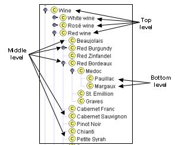
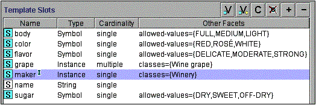
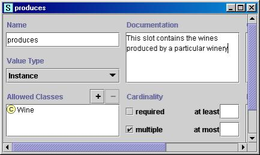
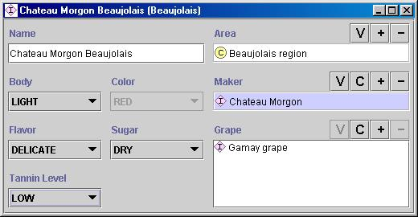

# 3 簡単な知識工学（knowledge engineering）の方法論（A Simple Knowledge-Engineering Methodology）

[目次へ戻る](README.md) ／ [原文（英語）](https://protege.stanford.edu/publications/ontology_development/ontology101-noy-mcguinness.html)

前にも述べたように、オントロジーを開発する「正しい」やり方や方法論は一つではない。ここでは、考えておくべき一般的な問題を論じ、オントロジーを開発するための一つの手順を示す。私たちが説明するのは、オントロジー開発を繰り返しによって進めるやり方である。まず、オントロジーの大まかな第一版を作る。次に、育ちつつあるオントロジーを見直して磨き上げ、細部を埋めていく。その途中で、設計者が下さなければならないモデリング（modeling）上の判断や、さまざまな解決策の長所・短所・影響についても論じる。

まず、オントロジー設計の基本的な規則をいくつか強調しておきたい。これらの規則には、これから何度も立ち返ることになる。これらの規則はかなり独断的に見えるかもしれない。しかし、多くの場合、設計上の判断を下す助けになる。

> *1) ドメインをモデル化する唯一の正しいやり方というものはない――常に、ほかにも実行可能な選択肢がある。最善の解決策は、ほぼ必ず、念頭に置いているアプリケーションと、予想される拡張によって決まる。*

> *2) オントロジーの開発は、必然的に、繰り返しのプロセスである。*

> *3) オントロジーの概念は、関心のあるドメインの物（物理的なもの、または論理的なもの）や関係に近いものであるべきである。それらは、ドメインを記述する文の中の名詞（物）や動詞（関係）である可能性が高い。*

つまり、オントロジーを何に使うのか、オントロジーをどのくらい詳細に、あるいはどのくらい一般的にするのかを決めることが、その後の多くのモデリング上の判断の指針となる。実行可能ないくつかの選択肢の中から、想定する作業にとってどれがよりうまく働き、より直感的で、より拡張しやすく、より保守しやすいかを決める必要がある。また、オントロジーは現実世界のモデルであり、オントロジーの概念はその現実を反映していなければならないことも忘れてはならない。オントロジーの最初の版を定義したら、それをアプリケーションや問題解決手法の中で使ってみたり、その分野の専門家と議論したり、あるいはその両方を行ったりして、評価し、誤りを直すことができる。その結果、最初のオントロジーはほぼ確実に見直しが必要になる。このような繰り返しによる設計のプロセスは、おそらくオントロジーのライフサイクル全体を通じて続くだろう。

**ステップ 1. オントロジーのドメインと範囲（scope）を決める**

オントロジーの開発は、そのドメインと範囲を定めることから始めるのがよいと私たちは考える。つまり、次のようないくつかの基本的な質問に答えるのである。

- オントロジーが扱うドメインは何か。

- オントロジーを何に使うのか。

- オントロジーの情報は、どのような種類の質問に答えを与えるべきか。

- 誰がオントロジーを使い、保守するのか。

これらの質問への答えは、オントロジーを設計する過程で変わるかもしれない。しかし、どの時点でも、それらの答えはモデルの範囲を絞る助けになる。

先に紹介したワインと料理のオントロジーを考えよう。料理とワインを表現することが、このオントロジーのドメインである。私たちは、このオントロジーを、ワインと料理のよい組み合わせを提案するアプリケーションに使うつもりである。

当然、さまざまな種類のワイン、主な料理の種類、ワインと料理のよい組み合わせや悪い組み合わせという考え方を記述する概念が、私たちのオントロジーに入ってくる。一方で、ワイナリーの在庫管理やレストランの従業員管理のための概念は、ワインや料理という考え方にいくらか関係はあっても、オントロジーに含まれる可能性は低い。

設計しているオントロジーを、ワイン雑誌の記事の自然言語処理を助けるために使うのであれば、オントロジーの概念について、同義語や品詞の情報を含めることが重要になるかもしれない。レストランの客がどのワインを注文するかを決める手助けに使うのであれば、小売価格の情報を含める必要がある。ワインの仕入れ担当者がワインセラーの在庫をそろえるのに使うのであれば、卸売価格や入手可能性が必要になるかもしれない。オントロジーを保守する人たちが、オントロジーの利用者とは異なる言語でドメインを記述するのであれば、それらの言語の間の対応づけを用意する必要があるかもしれない。

#### コンピテンシー質問

オントロジーの範囲を決める方法の一つは、そのオントロジーにもとづく知識ベースが答えられるべき質問のリスト、すなわち**コンピテンシー質問**（competency question）を書き出してみることである（Gruninger and Fox 1995）。これらの質問は、後でリトマス試験紙の役目を果たす。オントロジーには、これらの種類の質問に答えるのに十分な情報が含まれているか。答えるには、特定のレベルの詳しさや、特定の領域の表現が必要か。これらのコンピテンシー質問は下書きにすぎず、網羅的である必要はない。

ワインと料理のドメインでは、次のようなコンピテンシー質問が考えられる。

- ワインを選ぶとき、ワインのどの特性を考えるべきか。

- ボルドーは赤ワインか、白ワインか。

- カベルネ・ソーヴィニヨンはシーフードに合うか。

- グリルした肉に合うワインとして、最善の選択は何か。

- ワインのどの特性が、ある料理への合い方を左右するか。

- 特定のワインのブーケ（香り）やボディは、ヴィンテージ（vintage）の年によって変わるか。

- ナパのジンファンデルのよいヴィンテージはいつだったか。

この質問のリストから判断すると、オントロジーには、ワインのさまざまな特性やワインの種類、ヴィンテージの年（よい年と悪い年）、ふさわしいワインを選ぶうえで重要になる料理の分類、推奨されるワインと料理の組み合わせ、といった情報が含まれることになる。

**ステップ 2. 既存のオントロジーの再利用を検討する**

ほかの人がすでに何をしているかを検討し、既存の情報源を、自分たちの特定のドメインと作業に合わせて洗練し拡張できないかを確かめることは、ほとんどの場合、やってみる価値がある。自分たちのシステムが、すでに特定のオントロジーや統制語彙（controlled vocabulary）を採用しているほかのアプリケーションとやりとりする必要がある場合には、既存のオントロジーの再利用が必須の要件になることもある。多くのオントロジーはすでに電子的な形で手に入り、使っているオントロジー開発環境に取り込むことができる。オントロジーがどの形式体系（formalism）で表現されているかは、多くの場合問題にならない。多くの知識表現システムは、オントロジーを取り込んだり書き出したりできるからである。ある知識表現システムが特定の形式体系を直接扱えない場合でも、オントロジーをある形式体系から別の形式体系へ変換する作業は、たいてい難しくない。

Web 上や文献の中には、再利用できるオントロジーのライブラリがある。たとえば、Ontolingua のオントロジーライブラリ（[http://www.ksl.stanford.edu/software/ontolingua/](http://www.ksl.stanford.edu/software/ontolingua/)）や、DAML のオントロジーライブラリ（[http://www.daml.org/ontologies/](http://www.daml.org/ontologies/)）を使うことができる。誰でも利用できる商用のオントロジーもいくつかある（たとえば UNSPSC（[www.unspsc.org](http://www.unspsc.org)）、RosettaNet（[www.rosettanet.org](http://www.rosettanet.org)）、DMOZ（[www.dmoz.org](http://www.dmoz.org)））。

たとえば、フランスワインの知識ベースがすでに存在するかもしれない。この知識ベースと、その土台となっているオントロジーを取り込めれば、フランスワインの分類が手に入るだけでなく、ワインを区別し記述するために使われるワインの特性の分類についても、その第一版が手に入る。客がワインを買うときに検討するワインのプロパティのリストは、[www.wines.com](http://www.wines.com/) のような商用の Web サイトから、すでに手に入るかもしれない。

ただし、このガイドでは、関係するオントロジーはまだ存在しないものとして、オントロジーを一から開発することにする。

**ステップ 3. オントロジーの重要な用語を列挙する**

何かを述べたい、あるいは利用者に説明したいと思う用語を、すべてリストに書き出しておくと役に立つ。私たちが話題にしたい用語は何か。それらの用語はどのようなプロパティを持つか。それらの用語について何を言いたいか。たとえば、ワインに関係する重要な用語としては、`wine`、`grape`、`winery`、`location`、ワインの `color`、`body`、`flavor`、`sugar content`、`fish` や `red meat` のようなさまざまな種類の `food`、`white wine` のようなワインの下位の種類、などが挙がるだろう。最初のうちは、それらの用語が表す概念同士の重なり、用語の間の関係、概念が持ちうるプロパティ、概念がクラスなのかスロットなのか、といったことは気にせずに、用語の網羅的なリストを作ることが重要である。

続く二つのステップ――クラス階層の作成と、概念のプロパティ（スロット）の定義――は、互いに密接に絡み合っている。一方を先に済ませてから他方に取りかかる、というのは難しい。ふつうは、階層の中の概念をいくつか定義し、続いてそれらの概念のプロパティを記述し、ということを繰り返す。この二つのステップは、オントロジー設計のプロセスの中で最も重要なステップでもある。ここではそれらを簡単に説明し、続く二つの節で、考慮すべきより複雑な問題、よくある落とし穴、下すべき判断などを論じる。

**ステップ 4. クラスとクラス階層を定義する**

クラス階層を作るやり方には、いくつかのものがある（Uschold and Gruninger 1996）。

- **トップダウン**（top-down）の開発プロセスでは、ドメインで最も一般的な概念の定義から始め、続いてそれらの概念を特殊化していく。たとえば、`Wine` と `Food` という一般的な概念のクラスを作ることから始められる。次に、`Wine` クラスのサブクラスをいくつか作って特殊化する。`White wine`、`Red wine`、`Rosé wine` である。さらに、たとえば `Red wine` クラスを、`Syrah`、`Red Burgundy`、`Cabernet Sauvignon` などに分類していける。

- **ボトムアップ**（bottom-up）の開発プロセスでは、最も具体的なクラス、つまり階層の葉にあたるクラスの定義から始め、続いてそれらのクラスを、より一般的な概念にまとめていく。たとえば、まず `Pauillac` と `Margaux` のワインのクラスを定義する。次に、この二つのクラスの共通のスーパークラスとして `Medoc` を作る。`Medoc` は、さらに `Bordeaux` のサブクラスである。

- **組み合わせ**（combination）の開発プロセスは、トップダウンとボトムアップのやり方を組み合わせたものである。まず目立つ概念を定義し、続いてそれらを適切に一般化したり特殊化したりする。たとえば、`Wine` のようないくつかの最上位の概念と、`Margaux` のようないくつかの具体的な概念から始めることができる。次に、それらを `Medoc` のような中間レベルの概念と関係づける。そのあとで、フランスの地域ごとのワインのクラスをすべて作り出し、それによって中間レベルの概念をいくつも作り出したくなるかもしれない。

図 2 は、一般性のレベルの違いに応じた分け方の一例を示している。



```text
Wine                        ← 最上位レベル
├─ White wine               ← 最上位レベル
├─ Rosé wine                ← 最上位レベル
└─ Red wine                 ← 最上位レベル
   ├─ Beaujolais            ← 中間レベル
   ├─ Red Burgundy          ← 中間レベル
   ├─ Red Zinfandel
   ├─ Red Bordeaux          ← 中間レベル
   │  ├─ Medoc
   │  │  ├─ Pauillac        ← 最下位レベル
   │  │  └─ Margaux         ← 最下位レベル
   │  ├─ St. Emillion
   │  └─ Graves
   ├─ Cabernet Franc        ← 中間レベル（※）
   ├─ Cabernet Sauvignon
   ├─ Pinot Noir
   ├─ Chianti
   ├─ Petite Syrah          ← 中間レベル
   ├─ Sancerre
   └─ Muscadet
```

- 【訳注】（※）原文の図では、「中間レベル」の矢印 5 本のうち 4 本目の矢じりが、Cabernet Franc の行と Cabernet Sauvignon の行のちょうど間にある。矢印の線の終点が Cabernet Franc の行に近いので、Cabernet Franc に印を付けたが、Cabernet Sauvignon を指している可能性もある。
- 【訳注】原文の図では、Muscadet の下にも木の線が続いており、この下にさらにクラスが続いている可能性がある。

**図 2. `Wine` の分類体系におけるさまざまなレベル。`Wine` は最も一般的な概念である。`Red wine`、`White wine`、`Rosé wine` は一般的な最上位レベルの概念である。`Pauillac` と `Margaux` は階層の中で最も具体的なクラス（つまり最下位レベルの概念）である。**

これら三つの方法のどれも、本質的にほかより優れているわけではない。どのやり方を取るかは、そのドメインを個人がどう見ているかに強く左右される。開発者がドメインを体系的にトップダウンで見ているなら、トップダウンのやり方を使うほうが楽かもしれない。組み合わせのやり方は、多くのオントロジー開発者にとって最も楽なことが多い。「中間」にある概念は、そのドメインでより説明的な概念であることが多いからである（Rosch 1978）。

ワインについて考えるとき、まず最も一般的な分類を区別するところから考える傾向があるなら、トップダウンのやり方のほうがうまくいくかもしれない。むしろ具体的な例で足場を固めることから始めたいなら、ボトムアップのやり方のほうが適しているかもしれない。

どのやり方を選んでも、ふつうはクラスの定義から始める。ステップ 3 で作ったリストから、物を記述する用語ではなく、独立して存在する物を表す用語を選ぶ。これらの用語がオントロジーのクラスとなり、クラス階層の拠り所となる。[2] あるクラスのインスタンスであることによって、その物が必然的に（つまり定義によって）別のあるクラスのインスタンスにもなるかどうかを問うことで、クラスを階層的な分類体系に整理する。

> *クラス A がクラス B のスーパークラスであるならば、B のすべてのインスタンスは A のインスタンスでもある*

言い換えると、クラス B は、A の「一種（kind of）」である概念を表す。

たとえば、ピノ・ノワールのワインはどれも、必然的に赤ワインである。したがって、`Pinot Noir` クラスは `Red Wine` クラスのサブクラスである。

図 2 は、Wine オントロジーのクラス階層の一部を示している。クラス階層を定義するときに気をつけるべき点については、第 4 節で詳しく論じる。



クラス `Wine` のスロット一覧（Protégé-2000 の「Template Slots」画面の内容）

| 名前（Name） | 型（Type） | カーディナリティ（Cardinality） | その他のファセット（Other Facets） |
|---|---|---|---|
| body | Symbol | single | allowed-values={FULL,MEDIUM,LIGHT} |
| color | Symbol | single | allowed-values={RED,ROSÉ,WHITE} |
| flavor | Symbol | single | allowed-values={DELICATE,MODERATE,STRONG} |
| grape | Instance | multiple | classes={Wine grape} |
| maker（「I」のアイコン付き） | Instance | single | classes={Winery} |
| name | String | single | |
| sugar | Symbol | single | allowed-values={DRY,SWEET,OFF-DRY} |

**図 3. クラス `Wine` のスロットと、それらのスロットのファセット。`maker` スロットの横にある「I」のアイコンは、そのスロットに逆スロット（inverse slot）があることを示す（5.1 節）。**

**ステップ 5. クラスのプロパティ――スロット――を定義する**

クラスだけでは、ステップ 1 のコンピテンシー質問に答えるのに十分な情報にはならない。いくつかのクラスを定義したら、概念の内部構造を記述しなければならない。

私たちは、ステップ 3 で作った用語のリストから、すでにクラスを選び出した。残りの用語の大部分は、それらのクラスのプロパティである可能性が高い。そうした用語には、たとえば、ワインの `color`、`body`、`flavor` や `sugar content`、ワイナリーの `location` などがある。

リストにあるプロパティの一つひとつについて、それがどのクラスを記述するのかを決めなければならない。これらのプロパティが、クラスに付けられるスロットになる。たとえば、`Wine` クラスは次のスロットを持つ。`color`、`body`、`flavor`、`sugar` である。そして、クラス `Winery` は `location` スロットを持つ。

一般に、オントロジーのスロットになりうる物のプロパティには、いくつかの種類がある。

- ワインの `flavor` のような「内在的な」プロパティ

- ワインの `name` や、そのワインの産地を表す `area` のような「外在的な」プロパティ

- 物が構造を持つ場合の、その部分。物理的な「部分」と抽象的な「部分」（たとえば食事のコース）の両方がありうる。

- ほかの個体との関係。これは、クラスの個々のメンバーとほかのものとの間の関係である（たとえば、ワインとワイナリーの間の関係を表す、ワインの `maker` や、そのワインの原料となる `grape`）。

したがって、先に挙げたプロパティに加えて、`Wine` クラスに次のスロットを追加する必要がある。`name`、`area`、`maker`、`grape` である。図 3 は、クラス `Wine` のスロットを示している。

クラスのすべてのサブクラスは、そのクラスのスロットを**継承**する（inherit）。たとえば、クラス `Wine` のすべてのスロットは、`Red Wine` や `White Wine` を含む、Wine のすべてのサブクラスに継承される。`Red Wine` クラスには、さらに `tannin level` スロット（値は low（低い）、moderate（中程度）、high（高い））を追加する。`tannin level` スロットは、赤ワインを表すすべてのクラス（`Bordeaux` や `Beaujolais` など）に継承される。

スロットは、そのプロパティを持ちうる最も一般的なクラスに付けるべきである。たとえば、ワインの `body` と `color` は、クラス `Wine` に付けるべきである。ボディと色を持つインスタンスを持つ、最も一般的なクラスだからである。

**ステップ 6. スロットのファセットを定義する**

スロットは、値の型（value type）、許容値（allowed value）、値の数（カーディナリティ（cardinality））、そのスロットが取りうる値のその他の特徴を記述する、さまざまなファセットを持つことができる。たとえば、`name` スロット（「ワインの名前」という意味での）の値は、一つの文字列である。つまり、`name` は値の型が文字列型（String）のスロットである。スロット `produces`（「あるワイナリーがこれらのワインを `produces`（造る）」という意味での）は複数の値を持つことができ、その値はクラス Wine のインスタンスである。つまり、`produces` は値の型がインスタンス型（`Instance`）で、許容クラス（allowed class）が `Wine` のスロットである。

次に、よく使われるファセットをいくつか説明する。

#### スロットのカーディナリティ

スロットのカーディナリティは、スロットがいくつの値を持てるかを定める。単一カーディナリティ（single cardinality）（値を高々一つ許す）と複数カーディナリティ（multiple cardinality）（値をいくつでも許す）だけを区別するシステムもある。ワインの `body` は単一カーディナリティのスロットになる（一つのワインが持てるボディは一つだけである）。あるワイナリーが造るワインは、`Winery` クラスの複数カーディナリティのスロット `produces` に入る。

スロット値の数をより正確に記述するために、最小カーディナリティ（minimum cardinality）と最大カーディナリティ（maximum cardinality）を指定できるシステムもある。最小カーディナリティが N であるとは、スロットが少なくとも N 個の値を持たなければならないことを意味する。たとえば、Wine の `grape` スロットの最小カーディナリティは 1 である。どのワインも、少なくとも一つの品種（variety）のブドウから造られるからである。最大カーディナリティが M であるとは、スロットが持てる値が高々 M 個であることを意味する。単一品種のワインについては、`grape` スロットの最大カーディナリティは 1 である。これらのワインは、ただ一つの品種のブドウから造られるからである。最大カーディナリティを 0 にしておくと便利な場合もある。この設定は、特定のサブクラスについて、そのスロットが値を一つも持てないことを示す。

#### スロット値の型

値の型のファセットは、そのスロットにどのような型の値が入りうるかを記述する。よく使われる値の型を挙げる。

- **文字列型**（String）は最も単純な値の型で、`name` のようなスロットに使われる。値は単純な文字列である。

- **数値型**（Number）（より具体的な値の型として、浮動小数点型（Float）や整数型（Integer）が使われることもある）は、数値の値を持つスロットを記述する。たとえば、ワインの `price` は値の型を Float にできる。

- **ブール型**（Boolean）のスロットは、単純な「はい／いいえ」のフラグである。たとえば、スパークリングワインを別のクラスとして表さないことにした場合、ワインがスパークリングかどうかは、ブール型のスロットの値として表せる。値が「true」（「はい」）ならそのワインはスパークリングであり、値が「false」（「いいえ」）ならそのワインはスパークリングではない。

- **列挙型**（Enumerated）のスロットは、そのスロットの具体的な許容値のリストを指定する。たとえば、`flavor` スロットが三つの値 `strong`（強い）、`moderate`（中程度）、`delicate`（繊細）のうちの一つを取れる、と指定できる。Protégé-2000 では、列挙型のスロットはシンボル型（`Symbol`）である。

- **インスタンス型**（Instance）のスロットを使うと、個体の間の関係を定義できる。値の型が Instance のスロットでは、そのインスタンスの出どころとなる許容クラスのリストも定義しなければならない。たとえば、クラス `Winery` のスロット `produces` は、クラス `Wine` のインスタンスを値として持つことができる。[3]

図 4 は、クラス `Winery` におけるスロット `produces` の定義を示している。



スロット `produces` の定義画面の内容（Protégé-2000）

| 項目 | 内容 |
|---|---|
| 名前（Name） | produces |
| 説明（Documentation） | このスロットは、あるワイナリーが造るワインを入れる（原文：This slot contains the wines produced by a particular winery） |
| 値の型（Value Type） | Instance |
| 許容クラス（Allowed Classes） | Wine |
| カーディナリティ（Cardinality） | required（必須）：チェックなし ／ multiple（複数）：チェックあり ／ at least（最小）：空欄 ／ at most（最大）：空欄 |

**図 4. ワイナリーが造るワインを記述するスロット `produces` の定義。このスロットのカーディナリティは multiple（複数）、値の型はインスタンス型（Instance）で、値の許容クラスはクラス `Wine` である。**

#### スロットのドメインとレンジ

インスタンス型のスロットの許容クラスは、しばしばスロットの**レンジ**（range）と呼ばれる。図 4 の例では、クラス `Wine` が `produces` スロットのレンジである。スロットを特定のクラスに付けるときに、そのスロットのレンジを制限できるシステムもある。

スロットが付けられているクラス、つまりスロットがそのプロパティを記述するクラスは、そのスロットの**ドメイン**（domain）と呼ばれる。`Winery` クラスは `produces` スロットのドメインである。スロットをクラスに*付ける*システムでは、スロットが付けられているクラスが、ふつうそのスロットのドメインになる。ドメインを別に指定する必要はない。

スロットのドメインとレンジを決めるための基本的な規則は、似ている。

> *スロットのドメインやレンジを定義するときは、それぞれドメインやレンジになりうる、最も一般的なクラス（一つまたは複数）を見つける。*

> *一方で、一般的すぎるドメインやレンジを定義してはならない。スロットのドメインにあるすべてのクラスはそのスロットによって記述されるべきであり、スロットのレンジにあるすべてのクラスのインスタンスは、そのスロットに入りうる値であるべきである。レンジとして一般的すぎるクラスを選んではならない（つまり、レンジを THING にしたいとは思わないだろう）。しかし、すべての値を覆うクラスを選びたい。*

`produces` スロットのレンジとして、`Wine` クラスのサブクラスをすべて挙げるのではなく、単に `Wine` を挙げる。同時に、スロットのレンジを THING――オントロジーで最も一般的なクラス――にしたくはない。

より具体的に言えば、次のようになる。

> *スロットのレンジやドメインを定めるクラスのリストに、あるクラスとそのサブクラスが含まれているなら、サブクラスを取り除く。*

スロットのレンジに `Wine` クラスと `Red Wine` クラスの両方が含まれているなら、レンジから `Red Wine` を取り除ける。新しい情報を何も加えないからである。`Red Wine` は `Wine` のサブクラスなので、スロットのレンジは、`Wine` クラスのほかのすべてのサブクラスと同様に、それをすでに暗に含んでいる。

> *スロットのレンジやドメインを定めるクラスのリストに、あるクラス A のすべてのサブクラスが含まれているが、クラス A そのものは含まれていないなら、レンジにはサブクラスではなくクラス A だけを含めるべきである。*

スロットのレンジに `Red Wine`、`White Wine`、`Rose Wine` を含める（`Wine` の直接のサブクラス（direct subclass）をすべて列挙する）のではなく、レンジをクラス `Wine` そのものに絞ることができる。

> *スロットのレンジやドメインを定めるクラスのリストに、あるクラス A のサブクラスのうち、いくつかを除くすべてが含まれているなら、クラス A のほうがより適切なレンジの定義にならないかを検討する。*

スロットをクラスに付けることが、そのクラスをスロットのドメインに加えることと同じであるシステムでは、スロットの付け方にも同じ規則が当てはまる。一方では、できるだけ一般的になるように努めるべきである。他方では、スロットを付ける各クラスが、そのスロットの表すプロパティを本当に持ちうることを確かめなければならない。`tannin level` スロットは、赤ワインを表す各クラス（たとえば `Bordeaux`、`Merlot`、`Beaujolais` など）に付けることもできる。しかし、赤ワインはすべてタンニンの度合いというプロパティを持つのだから、代わりに、より一般的なクラスである `Red Wines` にスロットを付けるべきである。`tannin level` スロットのドメインをさらに一般化する（代わりに `Wine` クラスに付ける）のは正しくない。たとえば、白ワインを記述するのにタンニンの度合いは使わないからである。

**ステップ 7. インスタンスを作る**

最後のステップは、階層の中のクラスの個々のインスタンスを作ることである。クラスの個々のインスタンスを定義するには、(1) クラスを選び、(2) そのクラスの個々のインスタンスを作り、(3) スロットの値を埋める必要がある。たとえば、ボージョレワインの特定の種類を表すために、個々のインスタンス `Chateau-Morgon-Beaujolais` を作ることができる。`Chateau-Morgon-Beaujolais` は、すべてのボージョレワインを表すクラス `Beaujolais` のインスタンスである。このインスタンスには、次のスロット値が定義されている（図 5）。

- Body（ボディ）: Light（ライト）

- Color（色）: Red（赤）

- Flavor（風味）: Delicate（繊細）

- Tannin level（タンニンの度合い）: Low（低い）

- Grape（ブドウ）: Gamay（`Wine grape` クラスのインスタンス）

- Maker（造り手）: Chateau-Morgon（`Winery` クラスのインスタンス）

- Region（地域）: Beaujolais（`Wine-Region` クラスのインスタンス）

- Sugar（糖度）: Dry（辛口）



インスタンス `Chateau Morgon Beaujolais`（クラス `Beaujolais`）の画面の内容（Protégé-2000）

| スロット | 値 |
|---|---|
| Name | Chateau Morgon Beaujolais |
| Area | Beaujolais region（クラス） |
| Body | LIGHT |
| Color | RED |
| Maker | Chateau Morgon（インスタンス） |
| Flavor | DELICATE |
| Sugar | DRY |
| Grape | Gamay grape（インスタンス） |
| Tannin Level | LOW |

**図 5. `Beaujolais` クラスのインスタンスの定義。このインスタンスは、ボージョレ地域の `Chateaux Morgon Beaujolais` で、Chateau Morgon ワイナリーがガメイ種のブドウから造ったものである。ライトなボディ、繊細な風味、赤い色、低いタンニンの度合いを持つ。辛口のワインである。**

---

**原注**

[2] クラスを単項述語（unary predicate）――引数が一つの問い――とみなすこともできる。たとえば、「この物はワインか？」である。単項述語（つまりクラス）は、二項述語（binary predicate）（つまりスロット）――引数が二つの問い――と対比される。たとえば、「この物の風味は強いか？」「この物の風味は何か？」である。

[3] システムによっては、インスタンス型のスロットであることを特別に宣言することを求めず、単にクラスで値の型を指定するものもある。
